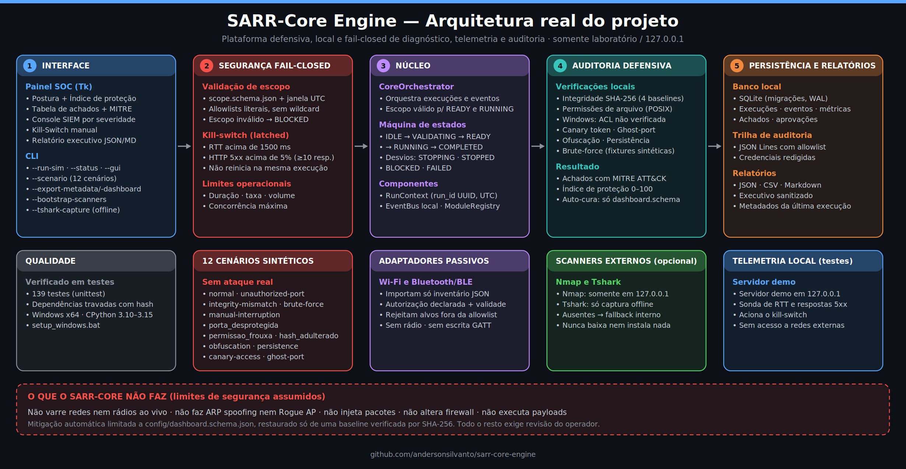
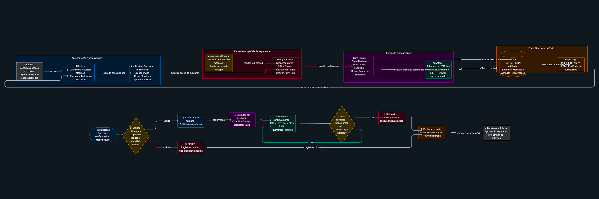

# SARR-Core Engine

<p align="center"></p>
<p align="center"></p>
<p align="center"></p>
<p align="center"><a href="assets/fluxograma-arquitetura.png">Abrir o fluxograma em tamanho original</a></p>

Motor local de auditoria defensiva, telemetria e resposta fail-closed. A
interface e a simulação priorizam evidências locais ou sintéticas e não
executam ações ofensivas.

## Documentação e recursos visuais

- [Visão do projeto](docs/visao-do-projeto.txt)
- [Arquitetura em texto](docs/arquitetura.txt)
- [Documento de arquitetura, casos de uso e fluxogramas](docs/arquitetura-sarr-core.pdf)
- [Plano de implementação](docs/plano-implementacao-sarr-core.pdf)
- [Ilustração conceitual (gerada por IA, não representa o escopo real)](assets/Arquitetura_do_SARR-Core_Engine.png)

## Núcleo de orquestração

O pacote `core` em `src/core/` fornece o `CoreOrchestrator`, a máquina de
estados de execução, `RunContext`, o `EventBus` local e o `ModuleRegistry`.
Cada execução é registrada com `run_id` UUID, timestamp UTC e modo não vazio.
O registro rejeita IDs repetidos e a máquina rejeita transições fora do fluxo:

- `IDLE -> VALIDATING`
- `VALIDATING -> READY | STOPPING | BLOCKED | FAILED`
- `READY -> RUNNING | STOPPING | BLOCKED | FAILED`
- `RUNNING -> STOPPING | BLOCKED | FAILED | COMPLETED`
- `STOPPING -> STOPPED | FAILED`
- `BLOCKED -> VALIDATING | STOPPING`

`COMPLETED`, `STOPPED` e `FAILED` são estados terminais.

## Escopo e limites de segurança

Toda transição do orquestrador para `READY` ou `RUNNING` exige um escopo válido
em `schemas/scope.schema.json`. O JSON deve identificar engagement, ambiente,
modo, janela UTC, allowlists literais de alvos/módulos e limites operacionais.
Wildcards, campos extras, IDs duplicados no JSON, escopos expirados e valores
solicitados fora das allowlists são rejeitados; qualquer falha aciona o
kill-switch central e bloqueia a execução.

Os limites por escopo são duração (segundos), taxa média (operações/s) e volume
(bytes) dentro da janela móvel configurada, mais concorrência máxima. RTT
acima de 1500 ms interrompe imediatamente. A taxa HTTP 5xx acima de 5% aciona
o kill-switch a partir de 10 respostas na janela. O kill-switch é latched:
quando acionado, interrompe execuções ativas e não pode ser reiniciado no
mesmo orquestrador.

## Persistência e auditoria

A camada SQLite usa migrações versionadas por `PRAGMA user_version`, chaves
estrangeiras, WAL e transações aninhadas com savepoints. `Persistence` reúne
repositórios para execuções, eventos, métricas, achados e aprovações. Ao
fornecê-la ao orquestrador, os eventos passam a ser persistidos em SQLite e
exportados como JSON Lines:

```python
from core import CoreOrchestrator, Persistence

persistence = Persistence("data/sarr.sqlite3", "logs/audit.jsonl")
engine = CoreOrchestrator(persistence=persistence)
```

O audit registra `run.started`, `scope.validated`, `metric.sample`,
`safety.triggered`, `run.stopped` e `finding.created`. Os payloads são
allowlisted por tipo de evento; credenciais em chaves ou textos reconhecidos
são redigidas, e campos arbitrários não são exportados. Para exportar uma
cópia consistente do arquivo:

```python
persistence.export_jsonl("exports/audit.jsonl")
persistence.close()
```

## Ambiente Windows

O setup suportado nesta etapa é Windows x64 com CPython 3.10–3.15. Crie o
ambiente virtual na raiz do projeto, caso ainda não exista:

```bat
py -3.15 -m venv .venv
```

O comando acima é apenas o bootstrap para criar o venv. Depois disso, os
scripts em `scripts/` usam exclusivamente `.venv\Scripts\python.exe`.
`setup_windows.bat` instala dependências apenas de `requirements-lock.txt`,
com hashes SHA-256 obrigatórios, instala o projeto sem resolver dependências
novamente e executa a suíte:

```bat
scripts\setup_windows.bat
scripts\run_windows.bat
```

O lock contém wheels Windows x64 para CPython 3.10–3.15. O ambiente atualmente
validado neste workspace é CPython 3.15; versões anteriores devem ser
homologadas em máquina limpa antes de uma distribuição ampla.

Para executar o teste de importação diretamente:

```bat
.venv\Scripts\python.exe -m unittest discover -s tests -v
```

Para incluir também o smoke test (`smoke_test.py`), use:

```bat
.venv\Scripts\python.exe -m unittest discover -s tests -p "*test*.py" -v
```

O setup Windows usa esse padrão para executar a suíte completa.

## CLI local

Execute os comandos da raiz do projeto usando sempre o Python do ambiente
virtual:

```bat
.venv\Scripts\python.exe -m sarr_core --status
.venv\Scripts\python.exe -m sarr_core --run-sim
.venv\Scripts\python.exe -m sarr_core --run-sim --scenario unauthorized-port
.venv\Scripts\python.exe -m sarr_core --run-sim --scenario porta_desprotegida
.venv\Scripts\python.exe -m sarr_core --run-sim --scenario permissao_frouxa
.venv\Scripts\python.exe -m sarr_core --run-sim --scenario hash_adulterado
.venv\Scripts\python.exe -m sarr_core --run-sim --scenario obfuscation
.venv\Scripts\python.exe -m sarr_core --run-sim --scenario persistence
.venv\Scripts\python.exe -m sarr_core --run-sim --scenario canary-access
.venv\Scripts\python.exe -m sarr_core --run-sim --scenario ghost-port
.venv\Scripts\python.exe -m sarr_core.cli --gui
```

Também é possível chamar o módulo da CLI diretamente com
`.venv\Scripts\python.exe -m sarr_core.cli --status` ou `--run-sim`.

No Linux/macOS, o equivalente é
`.venv/bin/python -m sarr_core.cli --gui`. O diretório persistente usa
`LOCALAPPDATA` no Windows e segue `XDG_DATA_HOME` (ou `~/.local/share`) no
Linux; no macOS usa `~/Library/Application Support`.

`--gui` abre o painel SOC Tk local: postura (`SEGURO`, `VULNERÁVEL` ou
`ATAQUE / KILL-SWITCH`), índice de proteção (0–100), tabela de achados, console
SIEM com severidade e controles para iniciar a auditoria, acionar o kill-switch
manual ou restaurar referências conhecidas. A interface importa a fachada
`sarr_core.simulation`; não manipula diretamente a máquina de estados ou os
repositórios do motor. Após uma auditoria, o painel permite exportar um
relatório executivo sanitizado em JSON ou Markdown. A tabela apresenta nomes e
impactos em linguagem simples, com indicador verde para postura segura, amarelo
para atenção e vermelho para bloqueio crítico. O detalhe do achado mantém a
referência técnica e as evidências; a ação rápida copia a orientação sem executar
comandos. A mitigação automática só é habilitada para restaurar
`config/dashboard.schema.json` de sua referência verificada.

Para exportar o JSON da última execução persistida ou o schema do dashboard:

```bat
.venv\Scripts\python.exe -m sarr_core.cli --export-metadata
.venv\Scripts\python.exe -m sarr_core.cli --export-dashboard
.venv\Scripts\python.exe -m sarr_core.cli --bootstrap-scanners
```

Os metadados são exportados somente se houver uma execução no banco local, em
`data/exports/metadata-latest.json` (ou no diretório de dados resolvido). O
schema versionado em `schemas/dashboard.schema.json` é copiado para
`config/dashboard.schema.json`. As flags de exportação podem ser combinadas
com `--status` ou `--run-sim`.

A máquina de estados também está disponível pelo namespace público
`sarr_core.core` (`Engine`, `EngineState` e `RunContext`). Ela aplica o mesmo
grafo estrito de transições; validação de escopo e autorização de operações
continuam centralizadas em `CoreOrchestrator`, que é o fluxo recomendado para
execução real ou simulada.

`--status` não inicia uma execução. `--run-sim` cria e valida um escopo
temporário restrito a `127.0.0.1`, depois processa inventário local, hashes dos
schemas do projeto e cenários sintéticos. O fluxo padrão não abre sockets nem
envia requisições; se Nmap estiver instalado, é feita uma verificação TCP
limitada ao endereço local `127.0.0.1`, sem tentativa de autenticação. Os cenários
disponíveis são `normal`, `unauthorized-port`, `integrity-mismatch`,
`brute-force`, `manual-interruption`, `porta_desprotegida`,
`permissao_frouxa`, `hash_adulterado`, `obfuscation`, `persistence`,
`canary-access` e `ghost-port`; os cenários de risco disparam o kill-switch e terminam em
`BLOCKED`. Ofuscação, comandos subprocess simulados e mecanismos de persistência
são analisados somente como cenários estáticos; nenhum payload é decodificado
ou executado, e nenhum processo, tarefa agendada ou chave de inicialização é
consultado.
Achados exportados incluem vetor de ataque, remediação, referência MITRE
ATT&CK e ação de bloqueio; as descrições de ataque são explicativas e não
executam exploração. Os hashes de referência dos schemas são
fixados no código e precisam ser revisados intencionalmente quando esses arquivos
forem atualizados. A verificação de permissões POSIX é somente leitura; no
Windows, a auditoria registra explicitamente que ACLs não foram verificadas.
O FIM também verifica arquivos conhecidos de `config/` e `schemas/`; arquivos
adicionais sem referência aprovada são críticos e bloqueiam a execução. As
simulações atômicas T1083, T1046 e T1222 limitam-se à enumeração local de
arquivos e a inventários fornecidos/sintéticos, sem varredura de rede ou
alteração de permissões. “Restaurar referências” pode restaurar somente
`config/dashboard.schema.json`, depois de verificar `schemas/dashboard.schema.json`
contra seu hash aprovado; em seguida, executa uma nova auditoria. Outros
achados requerem remediação revisada pelo operador.

`config/canary_credentials.json` contém exclusivamente um marcador fictício e
faz parte das referências de integridade. Uma adulteração detectada ou um sinal explícito de
acesso sintético gera `deception.canary.triggered` com severidade crítica e aciona o
kill-switch. O aplicativo não instala hooks nem monitora leituras externas do
sistema operacional; detecção geral de acesso exige telemetria autorizada do
host, não fornecida por esta simulação.

O Nmap, se encontrado, só é chamado com destino fixo `127.0.0.1`, timeout e
saída XML limitada. Portas encontradas são inventário informativo; não se
infere vulnerabilidade sem validação do serviço. O Tshark é verificado no
ambiente e sua API aceita apenas análise offline de arquivos `.pcap`/`.pcapng`
no diretório do projeto por meio de `--tshark-capture`; captura ao vivo é
desativada. A análise registra apenas contagem de frames e hash de metadados,
nunca conteúdo de pacotes. Para usar essa opção, forneça um arquivo autorizado
existente dentro do projeto. Se qualquer ferramenta estiver ausente ou falhar, o
CLI/GUI registra aviso e mantém o fallback de simulação local. O cenário
`ghost-port` é exclusivamente sintético: não abre
porta, envia pacotes ou captura requisições reais; registra somente um hash
fixo da assinatura de cenário.

`--bootstrap-scanners` e o botão correspondente no SOC verificam o PATH e os
diretórios padrão do Windows e exibem instruções `winget` para instalação
assistida. O aplicativo não baixa nem executa instaladores; revise o editor do
pacote e confirme a instalação manualmente. A correlação Nmap + Tshark só ocorre
quando ambos estão disponíveis e o operador fornece uma captura offline
autorizada dentro do projeto. Frames com protocolos em texto claro observados
em pacotes locais (`127.0.0.1`/`::1`) para portas TCP descobertas pelo Nmap
geram `network.correlation.vulnerability_detected` (crítico, T1040) e acionam
o kill-switch. A correlação não exporta payloads e não trata tráfego TLS como
texto claro.

A auto-cura mantém em memória cópias apenas de arquivos com SHA-256 igual às
referências embutidas na versão instalada. Uma alteração posterior à captura da
referência é substituída atomicamente e verificada; symlinks, arquivos sem
referência ou falhas de escrita continuam fail-closed e não são reparados.

## Diretório de dados

Por padrão, o motor usa o diretório persistente do usuário. Para modo portátil,
crie um arquivo vazio `portable.flag` ao lado do projeto ou executável; os
dados serão gravados em `data/` nesse diretório. A inicialização testa a
escrita e, se esse local não estiver disponível, emite aviso e tenta o
diretório persistente do usuário. Se ambos falharem, a execução é bloqueada.

## Preparação de release

O checklist atual e o status de prontidão estão em
[`release-checklist.md`](release-checklist.md). O estado é somente código-fonte: não
há executável portátil nem validação em uma máquina limpa nesta etapa.

## Testes legados de resiliência HTTP

O subsistema `core.demo_server` permanece disponível para os testes de
resiliência legados. Ele vincula um servidor de demonstração somente a
`127.0.0.1`; a CLI e o painel de auditoria atuais não o utilizam:

```python
from core import (
    KillSwitch,
    LocalDemoServer,
    LocalTelemetryProbe,
    OperationalLimitEnforcer,
    TelemetryScenario,
)

# Use o run_id e os limites de uma execução validada em um fluxo real.
with LocalDemoServer(TelemetryScenario.NORMAL_LATENCY) as server:
    probe = LocalTelemetryProbe(
        port=server.port,
        run_id=run_id,
        limits=operational_limits,
        kill_switch=kill_switch,
    )
    sample = probe.sample()
```

Os testes existentes para `TelemetryScenario` ainda verificam RTT, respostas
5xx, telemetria ausente e interrupção manual em `127.0.0.1`, sem acesso a redes
externas. Eles são infraestrutura de teste preexistente, não uma coleta de
métricas de hardware nem parte do fluxo atual de `--run-sim`.

## Relatórios estruturados de auditoria

O serviço de relatórios monta um resumo de uma execução com escopo validado,
incluindo SHA-256 do arquivo de escopo, operador, módulos registrados como
executados, horários, agregados métricos, achados, eventos do kill-switch,
motivo de parada, limitações e recomendações defensivas. Dados sensíveis são
sanitizados antes da serialização. Os formatos JSON e CSV são suportados sem
dependências adicionais; o painel local também exporta Markdown:

```python
from core import AuditReportService

report = AuditReportService(engine).build_report(run.run_id, operator="analyst")
AuditReportService.export_json(report, "reports/run.json")
AuditReportService.export_csv(report, "reports/run.csv")
AuditReportService.export_markdown(report, "reports/run.md")
```

Para registrar um módulo executado no relatório, use
`engine.record_module_execution(run_id, module_name)` durante uma execução
`RUNNING`; o módulo precisa estar autorizado pelo escopo validado.

## Inventário passivo Wi-Fi e Bluetooth/BLE

Os adaptadores `WifiInventoryAdapter` e `BluetoothGattInventoryAdapter`
importam somente arquivos JSON locais com inventários estruturados. Cada arquivo
precisa conter um registro de autorização com referência, aprovador, validade
UTC, allowlist explícita de endereços e atividade permitida. Os importadores
rejeitam inventários expirados, destinos fora da allowlist, campos extras,
chaves JSON duplicadas e propriedades GATT de escrita. Valores de
características/descriptors não são aceitos.

Estes adaptadores **não enumeram rádios nem fazem operações ao vivo**: não
escaneiam, associam, desautenticam, capturam credenciais, pareiam, leem
características GATT de dispositivos, injetam pacotes ou transmitem. A chamada
`collect_from_os()` falha explicitamente como stub não suportado. Somente os
conjuntos de dados sintéticos em `tests/fixtures/` acompanham os testes; eles usam
identificadores localmente administrados e nomes marcados como sintéticos.

O registro de autorização importado é evidência documental declarada no
arquivo, não uma assinatura criptográfica verificada pelo motor. Antes de
importar inventários reais, o operador deve validar a referência contra a
aprovação formal da organização e fornecer apenas dados coletados de forma
autorizada e passiva.
